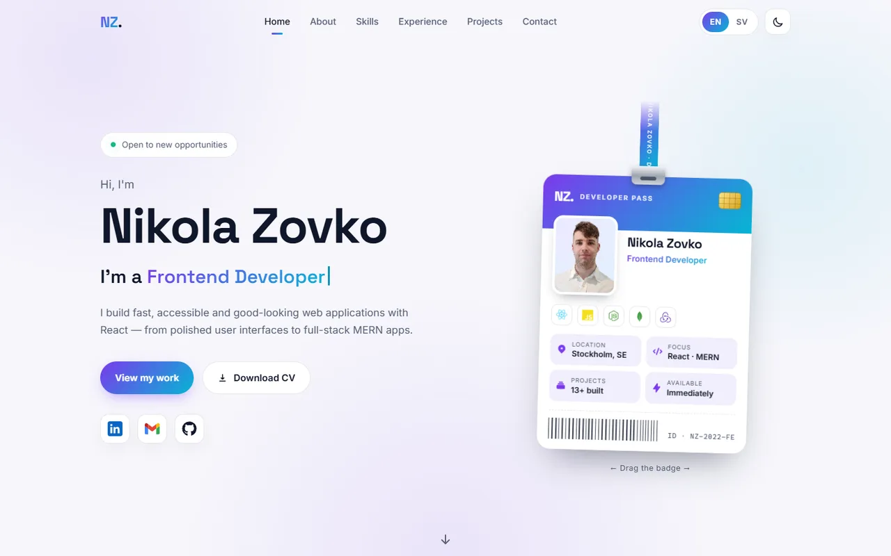
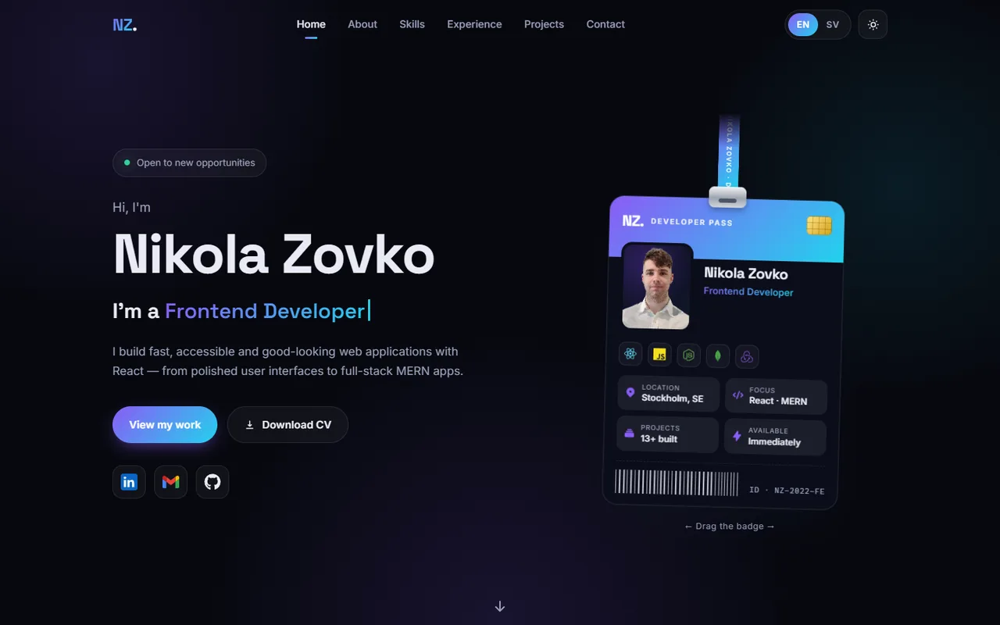
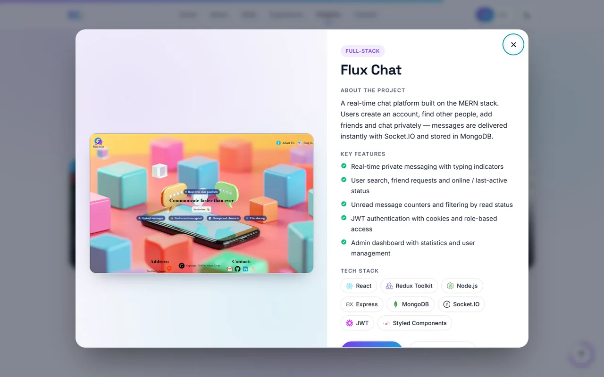
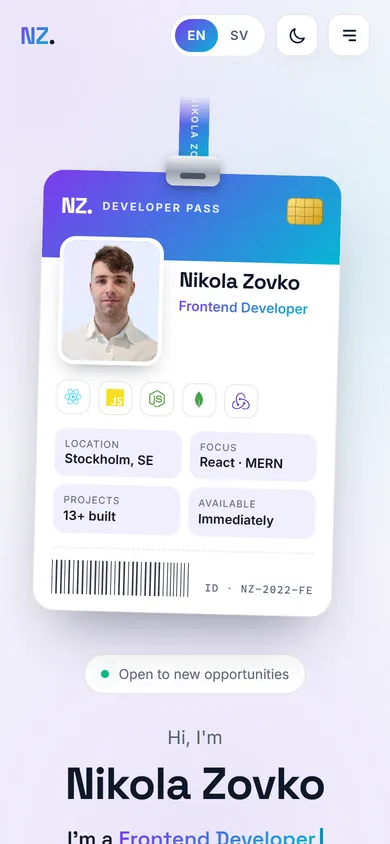
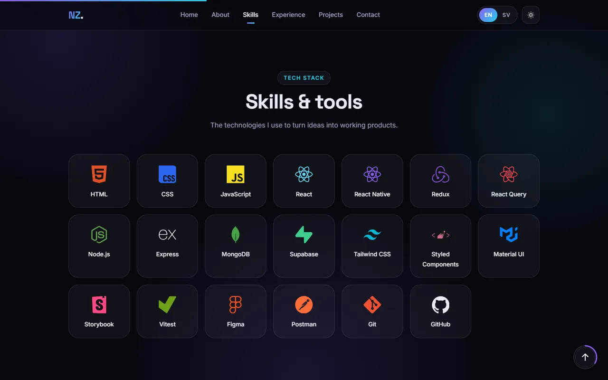

<div align="center">

# 👋 Nikola Zovko — Portfolio

<a href="https://nikolazovkoportfolio.netlify.app/#home" target="_blank">
  
</a>

**📍 Stockholm, Sweden · Open to new opportunities**

<a href="https://nikolazovkoportfolio.netlify.app/#home" target="_blank"></a>

[](https://www.linkedin.com/in/nikola-zovko-a50779247/)
[](https://github.com/Nikolaz95)
[](mailto:nikolajoe95@gmail.com)

</div>

<br />

<p align="center">
  
  
</p>

---

## 📖 About

This is my personal portfolio: a fast, animated single-page site that shows who I am, the technologies I work with and the projects I have built. It runs in **English and Swedish**, has **light and dark mode**, and visitors can **email me directly** from the page.

## ✨ Features

<table>
  <tr>
    <td width="50%" valign="top">

**🪪 Developer pass**<br />
An ID badge on a lanyard with my photo and key facts. It drops in on load, swings, and can be dragged.

**🌗 Light & dark mode**<br />
Light by default. The visitor's choice is remembered.

**🌍 English & Swedish**<br />
All texts are translated, and the CV download follows the selected language.

**🎞️ Animations**<br />
Typewriter intro, scroll-in sections, animated menus and a scroll-progress bar.

</td>
    <td width="50%" valign="top">

**🗂️ Project carousel + modal**<br />
Swipe, drag or use the arrows. Click a project to see its details, features, tech stack and links.

**✉️ Working contact form**<br />
Sends email straight to my inbox with EmailJS, with validation and success/error messages.

**📱 Responsive**<br />
Mobile menu, bottom-sheet modal on phones and a back-to-top button with a progress ring.

**♿ Accessible**<br />
Keyboard navigation, focus handling, ARIA labels and support for reduced motion.

</td>
  </tr>
</table>

## 📸 Screenshots

<p align="center">
  
  &nbsp;
  
</p>
<p align="center">
  
</p>

## 🚀 Featured projects

These are some of the projects shown in the portfolio:

| Project              | Description                                                            | Stack                           | Links                                                                                                                                         |
| -------------------- | ---------------------------------------------------------------------- | ------------------------------- | --------------------------------------------------------------------------------------------------------------------------------------------- |
| **Flux Chat**        | Real-time chat with friends, typing indicators and an admin dashboard  | MERN · Socket.IO · JWT          | [Live](https://flux-chat-zsz2.onrender.com/) · [Code](https://github.com/Nikolaz95/ChatApp)                                                   |
| **Expense Tracker**  | Personal finance app with charts, categories and multiple currencies   | MERN · Redux Toolkit · Chart.js | [Live](https://mern-expense-tracker-vylg.onrender.com/) · [Code](https://github.com/Nikolaz95/MERN-Expense-Tracker)                           |
| **Movie App**        | Movies and TV shows from TMDB, with comments, favorites and a wishlist | MERN · Redux · JWT              | [Live](https://mern-movie-cpbh.onrender.com/) · [Code](https://github.com/Nikolaz95/MERN-MovieData)                                           |
| **Travel Diary**     | Digital travel diary with dates, notes, flags and visit statistics     | MERN · Redux · JWT              | [Live](https://mern-travel-50ly.onrender.com/) · [Code](https://github.com/Nikolaz95/MERN-Travel/tree/main)                                   |
| **Hotel Wild Oasis** | Hotel management for staff: cabins, bookings and check-ins             | React · Supabase · React Query  | [Live](https://nzhotel-wild-oasis-git-main-nikolas-projects-d50df3a6.vercel.app/login) · [Code](https://github.com/Nikolaz95/hotel-wildOasis) |

➡️ **All projects** are on the [live site](https://nikolazovko.netlify.app/#projects) and on my [GitHub](https://github.com/Nikolaz95).

## 🛠️ Built with

<p>
  
  
  
  
  
  
  
  
  
  
</p>

<details>
<summary><b>🔑 Environment variables (contact form)</b></summary>

<br />

The contact form uses [EmailJS](https://dashboard.emailjs.com/). Put these three keys in `portfolio/.env.local`. That file is ignored by git, so the keys are never uploaded.

| Variable                   | Where to find it in EmailJS     |
| -------------------------- | ------------------------------- |
| `VITE_EMAILJS_SERVICE_ID`  | Email Services → your service   |
| `VITE_EMAILJS_TEMPLATE_ID` | Email Templates → your template |
| `VITE_EMAILJS_PUBLIC_KEY`  | Account → General → Public Key  |

The EmailJS template can use `{{firstName}}`, `{{lastName}}`, `{{email}}`, `{{subject}}` and `{{message}}`.

</details>

<details>
<summary><b>📁 Project structure</b></summary>

<br />

```
PortfolioV2/
├── netlify.toml            Netlify build settings
├── docs/screenshots/       Images used in this README
└── portfolio/              The React app
    ├── public/cv/          CV files (English + Swedish)
    └── src/
        ├── components/
        │   ├── ui/         Reusable building blocks (Button, Carousel, Modal, Card, FormField …)
        │   ├── layout/     Header, Footer, ThemeToggle, LanguageSwitcher, ScrollToTop
        │   ├── icons/      Brand logos (LinkedIn, Gmail)
        │   └── sections/   Hero, About, Skills, Experience, Projects, Contact
        ├── data/           Content: projects, skills, experience, social links, CV
        ├── i18n/           All texts in English (en.js) and Swedish (sv.js)
        ├── hooks/          Reusable hooks (click outside, Escape key, scroll lock …)
        ├── services/       EmailJS
        ├── context/        Light / dark mode
        └── styles/         Themes, global styles and animation presets
```

Every larger component has two files: `Name.jsx` (logic + JSX) and `Name.styles.js` (styles).

</details>

<details>
<summary><b>🧩 Reusable components</b></summary>

<br />

All of these live in `portfolio/src/components/ui/`:

| Component                               | Example                                                                                               |
| --------------------------------------- | ----------------------------------------------------------------------------------------------------- |
| `Button`                                | `<Button href={url} external variant="outline" icon={FaGithub}>Code</Button>`                         |
| `IconButton`                            | `<IconButton icon={HiX} label="Close" onClick={close} />`                                             |
| `Carousel`                              | `<Carousel items={projects} getKey={(p) => p.key} renderItem={(p) => <ProjectCard project={p} />} />` |
| `Modal`                                 | `<Modal open={isOpen} onClose={close}>…</Modal>`                                                      |
| `Card`                                  | `<Card>…</Card>` or `styled(Card)`                                                                    |
| `Tag`                                   | `<Tag>React</Tag>` · `<Tag $variant="accent">Full-stack</Tag>`                                        |
| `FormField`                             | `<FormField label="Email" error={errors.email} {...register('email')} />`                             |
| `SocialLinks`                           | `<SocialLinks />`: LinkedIn, Gmail and GitHub buttons                                                 |
| `TechBadge`                             | `<TechBadge name="React" />`: technology logo and name                                                |
| `Section` / `SectionHeading` / `Reveal` | Section wrapper, section title, scroll-in animation                                                   |

</details>

<details>
<summary><b>✏️ Updating the content</b></summary>

<br />

No component code needs to change to update the content. All paths are inside `portfolio/src/`:

| What                            | Where                                                                                         |
| ------------------------------- | --------------------------------------------------------------------------------------------- |
| Texts (English / Swedish)       | `i18n/en.js`, `i18n/sv.js`                                                                    |
| Projects                        | `data/projects.js` + a screenshot in `assets/images/projects/` + texts in both language files |
| Skills                          | `data/skills.js`                                                                              |
| Experience & education          | `data/experience.js` + texts in both language files                                           |
| LinkedIn / Email / GitHub links | `data/social.js`                                                                              |
| CV                              | Put the PDF in `portfolio/public/cv/` and update `data/cv.js`                                 |
| Colors (light / dark)           | `styles/theme.js`                                                                             |

</details>

<details>
<summary><b>🌐 Deployment</b></summary>

<br />

The site is hosted on **Netlify** and is rebuilt automatically on every push to `main`. The build settings live in [`netlify.toml`](netlify.toml): it builds from the `portfolio/` folder and publishes `portfolio/dist/`.

To set it up: on Netlify, choose **Add new site → Import an existing project → GitHub** and select this repository. Then, under **Site configuration → Environment variables**, add the three `VITE_EMAILJS_*` keys.

</details>

---

<div align="center">

### 📬 Let's get in touch

I'm a frontend developer in Stockholm, **open to new opportunities**.<br />
Feel free to reach out on [LinkedIn](https://www.linkedin.com/in/nikola-zovko-a50779247/) or by [email](mailto:nikolajoe95@gmail.com).

<sub>Built with React and ☕ by Nikola Zovko</sub>

</div>
